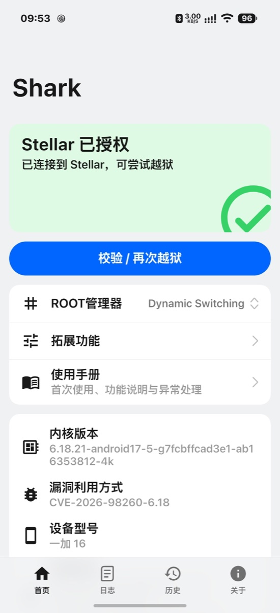
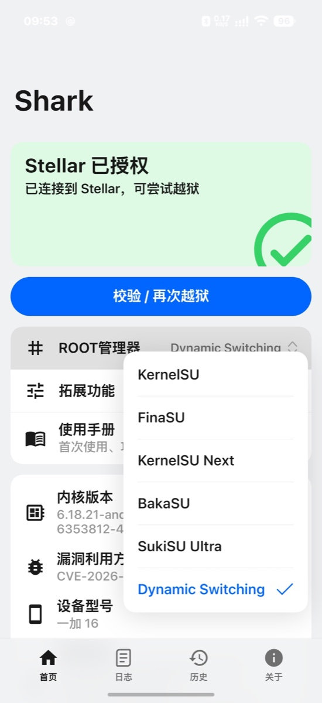
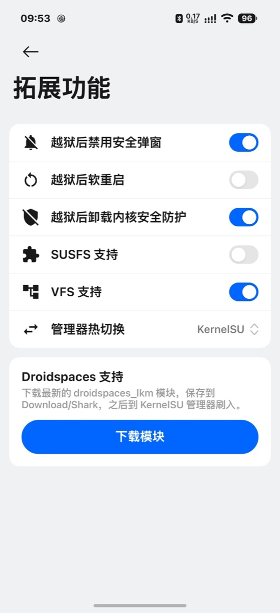

<h1 align="center"> Shark</h1>

<p align="center"><b>Multi-device Android one-click temporary root and root manager switching tool</b></p>

<p align="center">
  <a href="https://github.com/Yunnijian/Shark/releases/tag/v2.0"></a>
  <a href="LICENSE"></a>
  
  
  
  
  <a href="https://gitee.com/puci1/Shark/releases/tag/v2.0"></a>
</p>

<p align="center"><b>English</b> | <a href="README.zh-CN.md">简体中文</a></p>

Shark supports OnePlus, OPPO, Realme, iQOO, and Motorola devices without requiring an unlocked bootloader — you only need `adb shell` to get started. The app drives an on-device kernel exploit via Stellar or Shizuku to gain temporary kernel privileges, loads the LKM for your chosen root manager, and sets up a working KernelSU, KernelSU-Next, BakaSU, SukiSU Ultra, or FinaSU root environment.

## Screenshots

<table align="center">
  <tr>
    <td align="center"><br><sub><b>Home</b></sub></td>
    <td align="center"><br><sub><b>Root Manager</b></sub></td>
    <td align="center"><br><sub><b>Extras</b></sub></td>
  </tr>
  <tr>
    <td align="center"><br><sub><b>KernelSU</b></sub></td>
    <td align="center"><br><sub><b>BakaSU</b></sub></td>
    <td align="center"><br><sub><b>SukiSU Ultra</b></sub></td>
  </tr>
</table>

## Supported Devices

| Device | OS | Exact Kernel Release (`uname -r`) |
| --- | --- | --- |
| OnePlus 16 (PYB110) | ColorOS 17 | `6.18.21-android17-5-gf957accaf563-ab15926176-4k`<br>`6.18.21-android17-5-g7fcbffcad3e1-ab16353812-4k` |
| OnePlus 15 (PLK110) | ColorOS 17 | `6.12.69-android16-6-g242e1a07f878-ab15865446-4k`<br>`6.12.69-android16-6-g5fd39602326e-ab16372235-4k` |
| OnePlus 15T (PLZ110) | ColorOS 17 | `6.12.69-android16-6-g242e1a07f878-ab15865446-4k`<br>`6.12.69-android16-6-g5fd39602326e-ab16372235-4k` |
| OnePlus Ace7 Pro (PMS110) | ColorOS 17 | `6.12.69-android16-6-g242e1a07f878-ab15865446-4k`<br>`6.12.69-android16-6-g5fd39602326e-ab16372235-4k` |
| OnePlus Ace7 (PYF110) | ColorOS 17 | `6.12.69-android16-6-g242e1a07f878-ab15865446-4k`<br>`6.12.69-android16-6-g5fd39602326e-ab16372235-4k` |
| OnePlus Ace6T (PLR110) | ColorOS 17 | `6.12.69-android16-6-g242e1a07f878-ab15865446-4k`<br>`6.12.69-android16-6-g5fd39602326e-ab16372235-4k`<br>`6.12.38-android16-5-g844001fb8721-ab14552068-4k` |
| OnePlus Ace6 Ultra (PMB110) | ColorOS 17 | `6.12.69-android16-6-g242e1a07f878-ab15865446-4k`<br>`6.12.69-android16-6-g5fd39602326e-ab16372235-4k` |
| OnePlus Ace6 (PLQ110) | ColorOS 17 | `6.6.118-android15-8-g9bc34d5b0c79-abogki537459655-4k` |
| OnePlus Ace5 Pro (PKR110) | ColorOS 17 | `6.6.118-android15-8-g9bc34d5b0c79-abogki537459655-4k` |
| OnePlus Pad3 Pro (OPD2513) | ColorOS 16/17 | `6.12.69-android16-6-g242e1a07f878-ab15865446-4k`<br>`6.12.69-android16-6-g5fd39602326e-ab16372235-4k`<br>`6.12.58-android16-6-g7704a1ae279b-ab15213644-4k` |
| OnePlus Pad2 Pro (OPD2413) | ColorOS 17 | `6.6.118-android15-8-gc4127a25dcf3-ab15863337-4k` |
| OPPO Find X9 Ultra (PMA110) | ColorOS 17 | `6.12.69-android16-6-g242e1a07f878-ab15865446-4k`<br>`6.12.69-android16-6-g5fd39602326e-ab16372235-4k` |
| OPPO Find X9 Pro (PLG110) | ColorOS 17 | `6.12.69-android16-6-g242e1a07f878-ab15865446-4k`<br>`6.12.69-android16-6-g5fd39602326e-ab16372235-4k` |
| OPPO Find X9 (PLJ110) | ColorOS 17 | `6.12.69-android16-6-g242e1a07f878-ab15865446-4k`<br>`6.12.69-android16-6-g5fd39602326e-ab16372235-4k` |
| OPPO Find X9s Pro (PME110EX) | ColorOS 17 | `6.12.69-android16-6-g242e1a07f878-ab15865446-4k`<br>`6.12.69-android16-6-g5fd39602326e-ab16372235-4k` |
| OPPO Find X10 (PMX110) | ColorOS 17 | `6.12.69-android16-6-g242e1a07f878-ab15865446-4k`<br>`6.12.69-android16-6-g5fd39602326e-ab16372235-4k` |
| OPPO Find X8 Ultra (PKJ110) | ColorOS 17 | `6.6.118-android15-8-g9bc34d5b0c79-abogki537459655-4k` |
| OPPO Find N5 (PKH110) | ColorOS 17 | `6.6.118-android15-8-gc4127a25dcf3-ab15863337-4k` |
| OPPO Pad Mini (OPD2512) | ColorOS 16/17 | `6.12.69-android16-6-g242e1a07f878-ab15865446-4k`<br>`6.12.69-android16-6-g5fd39602326e-ab16372235-4k`<br>`6.12.58-android16-6-g7704a1ae279b-ab15213644-4k` |
| OPPO Pad 5 Pro (OPD2511) | ColorOS 17 | `6.12.69-android16-6-g242e1a07f878-ab15865446-4k`<br>`6.12.69-android16-6-g5fd39602326e-ab16372235-4k` |
| OPPO Pad4 Pro (OPD2409) | ColorOS 17 | `6.6.118-android15-8-gc4127a25dcf3-ab15863337-4k` |
| Realme GT8 Pro (RMX5200) | ColorOS 17 | `6.12.69-android16-6-g242e1a07f878-ab15865446-4k`<br>`6.12.69-android16-6-g5fd39602326e-ab16372235-4k` |
| Realme GT8 (RMX6699) | ColorOS 17 | `6.6.118-android15-8-g9bc34d5b0c79-abogki537459655-4k` |
| Realme GT7 Pro (RMX5010) | ColorOS 17 | `6.6.118-android15-8-g9bc34d5b0c79-abogki537459655-4k` |
| Realme Neo8 (RMX8899) | ColorOS 16/17 | `6.12.38-android16-5-g844001fb8721-ab14552068-4k`<br>`6.12.69-android16-6-g242e1a07f878-ab15865446-4k`<br>`6.12.69-android16-6-g5fd39602326e-ab16372235-4k` |
| iQOO 15 (V2505A) | OriginOS 6/7 | `6.12.23-android16-5-g41f4cb1fa7c7-abogki465038634-4k`<br>`6.12.58-android16-6-g0a092cc0037a-abogki521987229-4k`<br>`6.12.58-android16-6-gdd6fd5c98918-abogki543627742-4k` |
| iQOO 15 Ultra | OriginOS 7 | `6.12.58-android16-6-gdd6fd5c98918-abogki543627742-4k` |
| iQOO Pad Pro 8.8" | OriginOS 7 | `6.12.58-android16-6-gdd6fd5c98918-abogki543627742-4k` |
| iQOO Pad6 Pro | OriginOS 7 | `6.12.58-android16-6-gdd6fd5c98918-abogki543627742-4k` |
| Motorola Signature | Android 17 | `6.12.58-android16-6-gb0a9599c6c01-ab14987696-4k`<br>`6.12.58-android16-6-g09eda8c8505a-ab15950084-4k` |

## Supported Managers

KernelSU, KernelSU-Next, BakaSU, SukiSU Ultra, and FinaSU.

Manager APKs are **not** bundled with Shark. Standard mode runs `ksud` directly from the installed manager APK on your device, so **install the manager APK you plan to use first**.

## Features

- **One-Click Temporary Root**: No manual exploit selection is needed — the app automatically matches one of six chains (`6.18.21` / `6.12.69` / `6.12.38` / `6.12.58` / `6.12.23` / `6.6.118`) by `uname -r`. Tap **One-Click Root** once to complete privilege escalation, `ksud late-load`, module installation, and manager launch. Temporary root disappears on reboot; simply run it again after the next boot.
- **Five Root Managers**: Choose KernelSU, KernelSU-Next, BakaSU, SukiSU Ultra, or FinaSU directly from the Root Manager dropdown. The app is not locked to any single manager; install your preferred manager APK beforehand and Standard mode will execute its own `ksud` and LKM.
- **Hot-Switch Root Managers**: Supported on `6.18` and `6.12`. On a clean boot, select `Dynamic Switching` to load the universal KSU LKM (initialized as KernelSU), then select your target manager in **Extras → Hot-Switch Manager**. Switching updates the version code, features, private ioctl, and primary manager profile, then automatically relaunches the target manager without rebooting or re-exploiting.
- **Extras**: Load VFS provider on `6.18`; load SUSFS on `6.12` / V2505A; plus toggles for anti-root popup suppression, post-root soft reboot, and unloading kernel security guards (OPPO/ColorOS-specific guards are skipped automatically on V2505A and Motorola). Enable as needed — a failure in an optional toggle does not affect the already completed root session.
- **Live Logs & History**: Real-time scrolling execution logs. Every run saves a complete log to the History tab where it can be inspected, deleted, or swiped left to export and share.
- **Online Updates**: Checks Gitee Releases on startup and falls back to GitHub; downloads new releases in-app and verifies SHA-256 and APK signature before handing off to the system installer.
- **Droidspaces Support**: On `6.18`, fetch the latest `droidspaces_lkm` module in one tap, saved to `Download/Shark/` for flashing inside KernelSU Manager (not bundled inside the APK).

## Two Root Modes

### Standard Mode

Select one manager in the Root Manager dropdown. The app uses that installed manager APK's built-in `ksud` to load its own LKM, giving you that manager's native root environment.

Switching managers in Standard mode still requires a reboot.

### Dynamic Mode

Select `Dynamic Switching` in the Root Manager dropdown. The app uses the bundled `libksud_universal.so` to load the universal KSU LKM, starting with KernelSU as the initial manager.

Once loaded, the **Hot-Switch Manager** option appears under **Extras**: open the dropdown and pick the target manager. Selecting it switches immediately and relaunches the target manager app. Hot-switching only updates the in-kernel manager profile without unloading modules or rebooting.

Because the universal `.ko` shares the same module name and hooks as stock KSU, the initial load must happen on a clean boot without KSU already loaded; it cannot hot-replace an existing `kernelsu` module.

## Usage

1. Install the manager APK you want to use. If you plan to use `Dynamic Switching`, installing all five managers is recommended.
2. Start **Stellar** or **Shizuku** (via ADB or Wireless Debugging) and grant permission to Shark.
3. Choose either a standard manager or `Dynamic Switching` from the Root Manager dropdown.
4. Enable any optional toggles under **Extras** if needed.
5. Tap **One-Click Root** and wait until `DONE` appears in the log.
6. In Standard mode, open your manager app to grant root access; in `Dynamic Switching` mode, select your target manager in Extras and Shark will switch to it and open it automatically.

## Project Structure

Shark consists of the Android app, on-device exploit runners, and optional kernel modules.

```text
Shark/
├── app/                         Android App (Gradle project)
│   ├── app/src/main/java/com/shark/kty/
│   │   ├── MainActivity.kt      Four tabs, exploit flow, manager & extras state
│   │   ├── UpdateChecker.kt     Gitee / GitHub release updater
│   │   ├── HistoryStore.kt      Log persistence and run history
│   │   └── DroidspacesModule.kt Droidspaces module downloader
│   ├── app/src/main/jniLibs/arm64-v8a/
│   │   ├── libk61821.so         6.18.21 runner
│   │   ├── libk61269.so         6.12.69 runner
│   │   ├── libk61238.so         6.12.38 runner
│   │   ├── libk61258.so         6.12.58 runner
│   │   ├── libk61223.so         6.12.23 runner
│   │   ├── libk66118.so         6.6.118 runner
│   │   ├── libksud_universal.so Dual-KMI universal loader
│   │   ├── libsusfs_guard_lkm.so
│   │   ├── libsusfs_guard_lkm_612.so
│   │   └── libhybridmount.so
│   ├── app/src/main/assets/     manual.md, licenses, donate assets
│   └── gradle/
├── exploit/
│   ├── rust-k61821/             6.18.21 Rust runner
│   ├── rust-kplant/             6.12 / 6.6 Rust runner (Cargo features select K source)
│   └── src/                     plant_core.inc + K<version>_plant.c (one per kernel)
├── lkm/
│   ├── susfs4ksu-lkm/           SUSFS guard source
│   ├── hybridmount/             VFS provider source
│   └── susfs-tools/             SUSFS rule userspace tools
├── docs/screenshots/            README screenshots
├── ports/v2505a/                V2505A notes and verification logs
├── ports/coloros-61269/         6.12.69 dual-OTA build notes and recovery scripts
├── ports/pkj110-66118/          PKJ110 6.6.118 notes and verification logs
├── ports/moto-a171wvh/          Motorola Signature 6.12.58 port notes and verification
├── third_party/                 Third-party licenses and reference materials
├── NOTICE / LICENSE
└── README.md
```

**Module Overview**

- `app/`: Kotlin/Compose UI, Shizuku/Stellar execution bridge, exploit chain selection, extras switches, log viewer, and online updater.
- `exploit/`: Single-entry Rust runner and C plant handling privilege escalation, fake cred, `ksud late-load`, and post-exploit setup.
- `lkm/`: Sources and build scripts for the SUSFS guard LKM and Hybrid Mount VFS provider.
- `ports/`: Per-device porting notes, extracted kernel constants, recovery scripts, and verification records.
- `third_party/`: Full third-party license texts and reference materials.

**Tech Stack**

- App: Kotlin, Jetpack Compose, COUI-Kit, Shizuku / Stellar API.
- On-device native: Rust + C, Android NDK arm64.
- Kernel side: C / GPL-2.0 LKMs; the universal KSU KO is built in the companion repository [KSU-Universal](https://github.com/Yunnijian/KSU-Universal).
- Tooling: Gradle Kotlin DSL, Cargo, Android SDK/NDK, Docker DDK.

## Building from Source

App (release requires configuring `app/keystore.properties`; use `:app:assembleDebug` for local testing builds):

```bash
cd app
./gradlew :app:assembleRelease
```

On-device runners (builds one `libk<version>.so` per kernel and copies it into `jniLibs`):

```bash
export ANDROID_NDK_HOME=/path/to/ndk
./exploit/build-all.sh
```

Or build an individual kernel target:

```bash
cd exploit/rust-kplant
cargo build --release --target aarch64-linux-android \
    --no-default-features --features k66118
```

Available features: `k61269`, `k61238`, `k61258`, `k61223`, `k66118`; `6.18.21` is built separately under `exploit/rust-k61821`.

The universal KO and dual-KMI loader are built in [KSU-Universal](https://github.com/Yunnijian/KSU-Universal); Shark bundles the prebuilt `libksud_universal.so`.

## Caveats & Safety

- `Dynamic Switching` must be loaded from a clean boot; subsequent manager switches do not require a reboot.
- Standard mode requires installing the chosen manager APK beforehand (`ksud` is not bundled by Shark).
- KPM is currently not enabled.
- CVE-2026-98260 relies on a race-condition UAF; any execution can trigger a kernel panic or unexpected reboot.
- Use only on your own hardware and at your own risk.

## Attribution & Licenses

- Original Shark code is licensed under GPL-3.0 (see [LICENSE](LICENSE)); third-party components are listed in [NOTICE](NOTICE).
- Universal KSU LKM is based on SukiSU Ultra (GPL-3.0).
- SUSFS guard and Hybrid Mount are licensed under GPL-2.0.
- CVE-2026-98260 exploit implementation references AzirX1337's public port (MIT).
- UI uses COUI-Kit (MPL-2.0); remote execution uses the Shizuku API (Apache-2.0) and Stellar API.

## Upstream Releases

- GitHub (upstream): https://github.com/Yunnijian/Shark/releases/tag/v2.0
- Gitee (upstream): https://gitee.com/puci1/Shark/releases/tag/v2.0
- App version: v2.0 (90)
- Upstream release APK SHA-256: `29dabba7fe144593a057715b30ccf0f1aaf5295b12d2883381f62fa6b10d3e94`

Universal kernel releases:

- https://github.com/Yunnijian/KSU-Universal/releases/tag/v1.1.0
- `ksu_universal-android16-6.12.ko`
- `ksu_universal-android17-6.18.ko`
- `ksud_universal`
